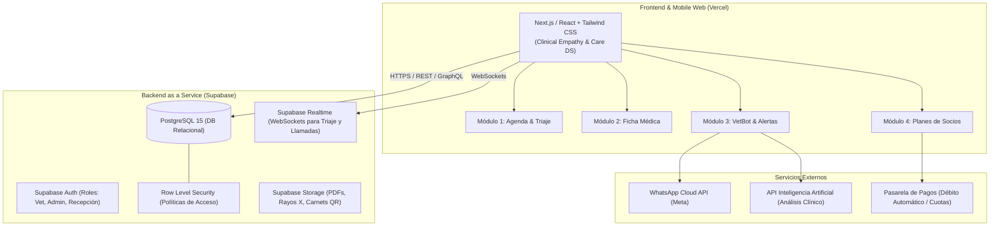

# 🏛️ VetCare Pro — Arquitectura de Software y Documentación Técnica
## Sistema Integral de Gestión Veterinaria y Planes de Socios

---

## 1. Visión General del Sistema

**VetCare Pro** es una plataforma médica veterinaria y de gestión de suscripciones sanitarias diseñada para clínicas, hospitales veterinarios y redes de atención de animales de compañía.

Combina:
1. **Atención Médica y Triaje en Vivo:** Agenda interactiva, clasificación de emergencias (spO2, temperatura), llamado a consultorios y consulta rápida.
2. **Historia Clínica y Ficha Sanitaria Completa:** Datos clínicos de pacientes, antecedentes quirúrgicos con protocolo anestésico (Ley 14.346), constantes vitales y libreta sanitaria oficial.
3. **VetBot & Mensajería Automática:** Automatizaciones vía WhatsApp Cloud API para recordatorios de vacunas y seguimiento posquirúrgico con análisis de evolución por IA.
4. **Sistema de Socios Particulares y Medicina Prepaga:** Modelo de membresías donde los tutores abonan una cuota fija mensual (ej. **$10.000/mes**) para que ante vacunas anuales o emergencias críticas no deban desembolsar montos elevados de imprevisto.

---

## 2. Diagrama de Arquitectura Global



---

## 3. Stack Tecnológico

| Capa | Tecnología | Justificación |
|---|---|---|
| **Frontend Framework** | **Next.js 14 / React 18 (TypeScript)** | Renderizado híbrido rápido, optimizado para móviles y desktop, SEO y enrutamiento modular. |
| **Estilos & UI** | **Tailwind CSS + Material Symbols** | Implementación fiel del sistema de diseño *Clinical Empathy & Care* (variables esmeralda, azul clínico, coral de urgencia y radios curvados). |
| **Base de Datos & Auth** | **Supabase (PostgreSQL 15)** | Motor SQL empresarial, autenticación de usuarios, suscripciones en tiempo real y seguridad a nivel de fila (RLS). |
| **Hosting & CI/CD** | **Vercel** | Despliegue continuo con sincronización automática mediante repositorio en **GitHub**, CDN global y *zero-config*. |
| **Almacenamiento (Storage)** | **Supabase Storage Buckets** | Almacenamiento seguro de recetas médicas PDF, fotos de pacientes y placas radiológicas. |
| **Tiempo Real** | **Supabase Realtime** | Notificación instantánea en pantalla al llamar a box y actualización de triajes críticos en tiempo real. |

---

## 4. Modelo de Negocio: Planes de Socios Particulares ($10.000 / mes)

### La Problemática
Una urgencia veterinaria promedio (atropello, torsión gástrica, insuficiencia respiratoria o cesárea) o un ciclo anual de vacunas y desparasitación puede costar entre **$80.000 y $300.000+ ARS** de golpe. Esto genera mora, abandono de tratamientos o endeudamiento familiar.

### La Solución: "Plan Socio Comunidad"
* **Cuota mensual:** **$10.000 ARS / mes** (débito automático bancario o tarjeta).
* **Beneficios inmediatos:**
  * **100% Cubierto en Urgencias 24/7:** Atención inicial y triaje sin costo sorpresa en guardia.
  * **100% Bonificado en Vacunas de Calendario Obligatorio:** Antirrábica, Séxtuple o Triple Felina cubiertas.
  * **50% de Cobertura en Cirugías e Internaciones:** Descuento directo en quirófano.
  * **Carnet Digital QR (VetCare Pass):** Validación instantánea en recepción por lector o DNI.
  * **Fondo de Ahorro Preventivo:** El sistema computa y muestra al tutor cuánto dinero ahorró en el año gracias a su plan.

---

## 5. Módulos Funcionales (Alineados con el Manual de Casos de Uso)

### 🗓️ Módulo 1: Agenda & Triaje del Día
* **Header de guardia:** Saludo al profesional, box asignado y botón de notificaciones con pulso activo.
* **Banner de Triaje Rojo (Urgencia Activa):** Muestra signos de alerta (SpO2, temperatura, sala asignada) y botón directo "Atender Ya".
* **KPIs diarios:** Citas del día, atendidas y urgencias resueltas.
* **Selector semanal & chips de filtro:** Filtrado instantáneo (Todos, Confirmados, En Espera, Urgencias).
* **Tarjetas con timeline:** Llamado a consultorio con feedback visual en pantalla (Toast).

### 🐾 Módulo 2: Ficha Médica e Historial Clínico
* **Hero del Paciente:** Foto, peso con tendencia, grupo sanguíneo (DEA 1.1), microchip RFID y tutor responsable.
* **Módulo de Contacto Rápido:** Llamada telefónica y acceso directo a WhatsApp con un tap.
* **Constantes vitales de base:** FC, FR y temperatura con estados de normalidad.
* **Secciones colapsables:** Historial de vacunas (con alertas de vencimiento), cirugías previas y consultas ambulatorias.
* **Emisión de Receta Digital:** Generación de PDF con número de matrícula provincial obligatorio (Ley 14.072).

### 🤖 Módulo 3: VetBot & Mensajes Automáticos
* **Switch maestro:** Activar o pausar la automatización global.
* **Canales de despacho:** WhatsApp Cloud API (primario), SMS Backup y Email.
* **Métricas de impacto:** Mensajes enviados, tasa de confirmación (94%) y vacunas rescatadas.
* **Flujo en tiempo real con IA:** Previsualización de mensajes por salir y lectura de respuestas de tutores categorizadas por inteligencia artificial ("Evolución favorable").

### 🏥 Módulo 4: Planes de Salud & Coberturas
* **Pestaña doble:** Suscripción activa del paciente vs. Catálogo comparativo de planes.
* **Carnet Digital con QR dinámico:** Guardable en Wallet digital y validable en mostrador.
* **Barra de consumo preventivo:** Progreso anual de consultas, vacunas aplicadas y limpiezas dentales.
* **Modal de validación rápida:** Búsqueda por DNI o aproximación de microchip RFID.
* **Modal de afiliación express:** Alta de mascota al plan con emisión instantánea de póliza.

---

## 6. Variables de Entorno Requeridas (.env.local)

```env
# Supabase
NEXT_PUBLIC_SUPABASE_URL=https://tu-proyecto.supabase.co
NEXT_PUBLIC_SUPABASE_ANON_KEY=tu-anon-key-publica
SUPABASE_SERVICE_ROLE_KEY=tu-service-role-key-privada

# Configuración de Clínica
NEXT_PUBLIC_CLINIC_NAME="VetCare Pro"
NEXT_PUBLIC_CURRENCY="ARS"
NEXT_PUBLIC_DEFAULT_PLAN_PRICE="10000"

# WhatsApp Business API (Meta Developer)
WHATSAPP_API_TOKEN=tu-whatsapp-token
WHATSAPP_PHONE_NUMBER_ID=tu-phone-number-id
```

---

## 7. Instrucciones para Despliegue en Vercel & GitHub

1. **Subir repositorio a GitHub:**
   ```bash
   git add .
   git commit -m "feat: Arquitectura VetCare Pro con Supabase y planes de socios"
   git remote add origin https://github.com/TU_USUARIO/TU_REPOSITORIO.git
   git branch -M main
   git push -u origin main
   ```
2. **Crear Proyecto en Supabase:**
   * Crear proyecto en [supabase.com](https://supabase.com).
   * Ir al **SQL Editor** y ejecutar en orden: `supabase/schema.sql` y `supabase/seed.sql`.
   * Copiar la URL del proyecto y la `anon key`.
3. **Conectar en Vercel:**
   * Ir a [vercel.com](https://vercel.com) e importar el repositorio de GitHub.
   * En *Environment Variables*, agregar `NEXT_PUBLIC_SUPABASE_URL` y `NEXT_PUBLIC_SUPABASE_ANON_KEY`.
   * Hacer clic en **Deploy**. El sistema compilará y quedará online con certificado SSL automático.
