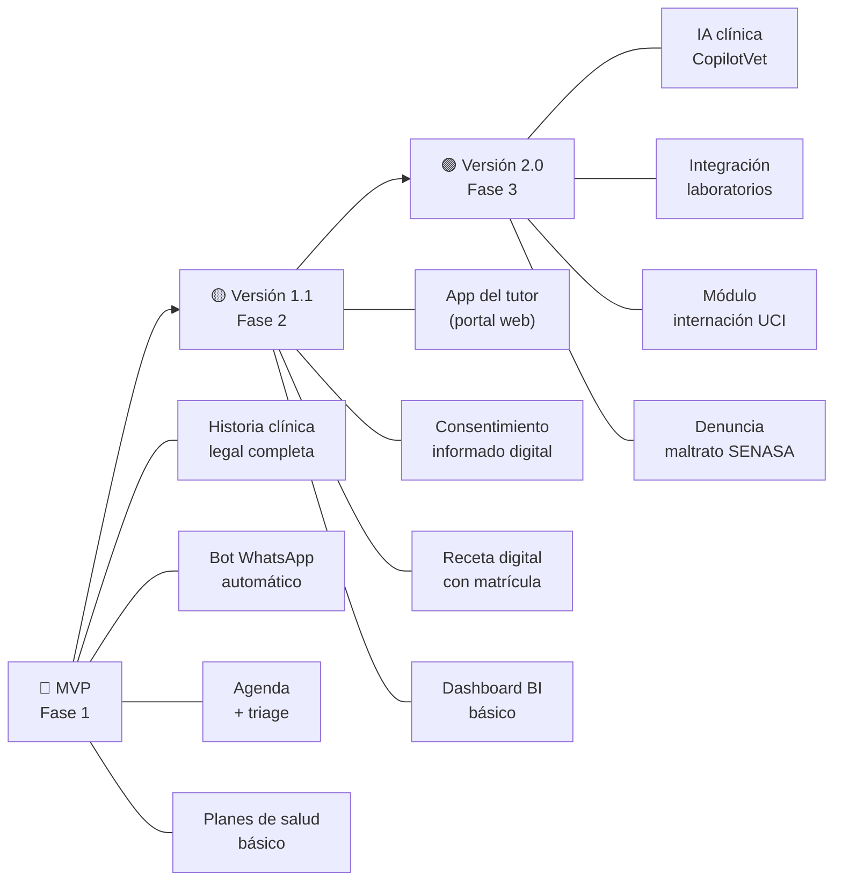

# 🔬 Investigación de Mercado, Competencia y Marco Legal
## VetCare Pro — Sistema Integral de Gestión Veterinaria

> [!IMPORTANT]
> Documento de investigación previo al desarrollo. Cubre competencia, operatoria de clínicas, oportunidades de valor agregado y normativa jurídica aplicable en Argentina.

---

## 📊 EL MERCADO — Contexto General

### Datos del Sector Veterinario en Argentina (2024–2026)

| Indicador | Dato |
|---|---|
| **Volumen económico del sector** | ~USD 3.200 millones/año (~0,5% del PBI) |
| **Perros y gatos estimados en Argentina** | 19–20 millones |
| **Hogares con al menos una mascota** | ~80% (una de las tasas más altas del mundo) |
| **Vía de incorporación dominante** | Adopción (63%) — no compra |
| **Posicionamiento regional** | Argentina y Brasil lideran el gasto per cápita en mascotas de Latinoamérica |
| **Tendencia de mayor crecimiento** | Gatos (boom felino) — impulsado por vida urbana y monoambientes |

### Tendencias que moldean el mercado

- **Humanización de mascotas**: el animal dejó de ser una posesión para ser un miembro de la familia. Los tutores invierten en salud, estética y bienestar igual que en seres humanos.
- **Premiumización selectiva**: el consumidor no paga más por la marca, sino por **valor real y comprobable**.
- **Medicina preventiva sobre medicina reactiva**: el modelo del futuro es la suscripción/abono preventivo, no la consulta por urgencia.
- **Digitalización acelerada**: el e-commerce de productos veterinarios y los turnos online 24/7 ya son expectativa mínima, no diferencial.
- **Especialización médica**: oncología, cardiología, kinesiología, medicina felina *cat-friendly*, nutrición clínica.

---

## 🏢 ANÁLISIS DE COMPETIDORES

### Mapa del Ecosistema

```
Competidores por segmento:
├── Empresarial / Multi-sede
│   ├── ezyVet (IDEXX) — Global, muy complejo, caro
│   └── Covetrus Pulse — Global, orientado a grupos hospitalarios
├── Mediana Clínica / PyME Veterinaria
│   ├── QVET — Líder hispanohablante, robusto
│   ├── VetPraxis App — Foco Latinoamérica, WhatsApp nativo
│   └── Núcleo Systems — BI + automatización
└── Pequeña Clínica / Clínica Independiente
    ├── GVET / Winby / VetCloud / Smart Vet
    ├── VetApp (Argentina) — Mobile-first
    └── PetDesk / VetDesk — Overlay de comunicación + app de tutor
```

---

### Tabla Comparativa Detallada

| Característica | **ezyVet** | **VetPraxis** | **QVET** | **PetDesk** | **VetApp AR** | **VetCare Pro** (nuestro) |
|---|---|---|---|---|---|---|
| **Foco geográfico** | Global | Latinoamérica | Hispanohablante | EEUU/Global | Argentina | Argentina |
| **Arquitectura** | Cloud enterprise | Cloud (AWS) | Cloud/local | Cloud overlay | Cloud mobile | Cloud mobile-first |
| **Historia clínica digital** | ✅ Avanzada | ✅ SOAP + voz | ✅ Completa | ⚠️ Básica | ✅ Buena | ✅ Diseñada |
| **Bot / Automatización** | ✅ SMS/email | ✅ WhatsApp nativo | ⚠️ Limitada | ✅ Push/SMS | ✅ Recordatorios | ✅ WhatsApp Business API |
| **App del tutor** | ⚠️ Portal web | ✅ App | ❌ No | ✅ App branded | ⚠️ Limitada | ⚠️ Pendiente de diseño |
| **Planes de salud/membresía** | ❌ No | ❌ No | ❌ No | ❌ No | ❌ No | ✅ **Módulo diseñado** |
| **IA / Análisis predictivo** | ⚠️ Incipiente | ❌ No | ❌ No | ❌ No | ❌ No | 🔮 Oportunidad clave |
| **Gestión de urgencias (triage)** | ✅ | ⚠️ Básico | ⚠️ Básico | ❌ | ❌ | ✅ **Módulo diseñado** |
| **Carnet digital QR** | ❌ | ❌ | ❌ | ⚠️ App card | ❌ | ✅ **Implementado** |
| **Facilidad de uso (UX)** | ⛔ Complejo | ✅ Buena | ⚠️ Media | ✅ Buena | ✅ Buena | ✅ **Excelente (diseño premium)** |
| **Precio mensual aprox.** | USD 300–1.500+ | USD 30–100 | USD 50–200 | USD 50–150 | USD 20–60 | A definir |
| **Multi-sucursal** | ✅ | ✅ | ✅ | ⚠️ | ⚠️ | 🔮 A desarrollar |
| **Integración AFIP/facturación AR** | ❌ | ⚠️ | ✅ | ❌ | ✅ | 🔮 A desarrollar |
| **Grooming / Hotel de mascotas** | ❌ | ✅ | ⚠️ | ❌ | ❌ | 🔮 Oportunidad |

---

### Análisis Individual de Competidores Clave

#### 🌐 ezyVet (propiedad de IDEXX)
- **Fortaleza máxima**: integración nativa con analizadores IDEXX, laboratorio, radiología PACS
- **Debilidad explotable**: curva de aprendizaje brutalmente alta, implementación de meses, precio inaccesible para clínicas medianas argentinas
- **¿Qué podemos aprender?** Su nivel de integración diagnóstica (lab + imagen) es el estándar de excelencia a apuntar a largo plazo

#### 🇱🇦 VetPraxis App
- **Fortaleza máxima**: WhatsApp Business nativo, dictado de notas clínicas por voz, módulo de grooming/hotel
- **Debilidad explotable**: sin planes de salud/membresía, sin análisis por IA, sin gestión de triage/urgencias
- **¿Qué podemos aprender?** Prioridad del canal WhatsApp en Latinoamérica (ya lo tenemos); dictado por voz es muy valorado por veterinarios

#### 🐾 PetDesk / VetDesk
- **Fortaleza máxima**: app del tutor con historial, push notifications, fidelización, recepcionista IA 24/7
- **Debilidad explotable**: es un *overlay*, no un sistema completo; sin historia clínica real
- **¿Qué podemos aprender?** La **app del tutor** es el diferencial más solicitado por los propietarios de mascotas

#### 🇦🇷 QVET
- **Fortaleza máxima**: la más adoptada en Argentina/España, facturación electrónica AFIP integrada, control de stock profundo
- **Debilidad explotable**: UX anticuada, mobile muy limitado, sin automatización real, sin planes de salud
- **¿Qué podemos aprender?** La integración fiscal (AFIP) es un *must* para el mercado argentino

---

## 🏥 CÓMO TRABAJAN LAS CLÍNICAS VETERINARIAS — Flujo Operativo Real

### Flujo de un día típico en una clínica veterinaria

```
07:00 — Apertura
  └── Revisión de agenda del día / urgencias de guardia nocturna

08:00 – 13:00 — Turno Mañana
  ├── Recepción: check-in de pacientes, confirmación de turnos
  ├── Sala de espera: clasificación por urgencia (triage informal)
  ├── Consultorio: anamnesis → examen físico → diagnóstico → prescripción
  ├── Laboratorio/Radiología: si hay estudios complementarios
  └── Farmacia/Stock: despacho de medicamentos recetados

13:00 – 15:00 — Pausa administrativa
  ├── Cierre de historias clínicas del turno
  ├── Llamados de seguimiento a pacientes internados
  └── Gestión de stock y pedidos a proveedores

15:00 – 20:00 — Turno Tarde
  └── (repite ciclo del turno mañana)

20:00 – 07:00 — Guardia
  └── Urgencias y emergencias (si la clínica ofrece servicio 24/7)
```

### Dolores más frecuentes que reportan las clínicas

| Dolor | Impacto | ¿Lo resuelve VetCare Pro? |
|---|---|---|
| Pacientes que no confirman el turno y no vienen | Alto — genera huecos en la agenda | ✅ Bot confirma automáticamente |
| Vacunas vencidas que el tutor desconoce | Alto — pérdida de oportunidad de ingreso | ✅ Alertas automáticas del Bot |
| Historia clínica en papel ilegible o incompleta | Muy alto — riesgo legal | ✅ HC digital estructurada |
| No saber si el paciente tiene cobertura al llegar | Alto — retrasa la atención | ✅ Validación por QR/chip |
| Tiempo perdido llamando por teléfono para recordar turnos | Alto — recepcionista saturada | ✅ Bot automático |
| Sin visibilidad del historial ante una urgencia | Crítico — riesgo de vida | ✅ Ficha accesible en tiempo real |
| Falta de seguimiento posquirúrgico | Medio — genera reingresos evitables | ✅ Bot de seguimiento 48/72h |
| Tutores que no saben qué desparasitante usar o cuándo | Medio — oportunidad educativa | ✅ Recordatorio inteligente |
| Recetario en papel — pérdida y falsificación | Alto — riesgo legal | ✅ Receta digital PDF |

---

## 💡 OPORTUNIDADES DE VALOR AGREGADO DIFERENCIAL

> Lo que **no tiene ninguna plataforma del mercado hispanohablante hoy** y VetCare Pro puede implementar.

### TIER 1 — Alta Prioridad (desarrollar primero)

#### 1. 📱 App para Tutores (Portal del Dueño)
- **Qué es**: app complementaria para el tutor de la mascota
- **Funciones**: ver carnet de vacunas digital, solicitar turno online 24/7, ver historial de consultas, recibir recordatorios push, ver recetas PDF, pagar online
- **Por qué es diferencial**: ningún competidor local lo tiene bien resuelto. PetDesk lo hace solo para EE.UU.
- **Impacto**: fidelización máxima, reduce llamados en recepción un 40–60%

#### 2. 🤖 IA Clínica Asistente — "CopilotVet"
- **Qué es**: motor de IA integrado al módulo de historia clínica
- **Funciones**:
  - Sugerencia de diagnósticos diferenciales basada en síntomas + especie + edad + raza
  - Calculadora automática de dosis por peso (ya visible en el diseño del sistema)
  - Alerta de interacciones medicamentosas
  - Predicción de riesgo (ej: pacientes con tendencia a patología renal según sus análisis históricos)
  - Autocompletado inteligente de notas clínicas (dictado por voz → texto estructurado)
- **Por qué es diferencial**: ningún software veterinario hispanohablante tiene esto integrado nativamente
- **Tecnología**: integración con API de Gemini / GPT-4o para NLP clínico

#### 3. 📊 Dashboard de Business Intelligence para la Clínica
- **Qué es**: tablero ejecutivo de métricas en tiempo real
- **Métricas clave**:
  - Ingresos por tipo de servicio (consulta, cirugía, vacuna, grooming)
  - Tasa de retención de pacientes (% que vuelve en 6 meses)
  - Ticket promedio por tutor y por mascota
  - Ocupación de boxes y tiempo promedio de consulta
  - Efectividad del bot (% de confirmaciones automáticas)
  - Stock crítico y medicamentos próximos a vencer
- **Por qué es diferencial**: los veterinarios NO son empresarios; este dashboard los convierte en gestores sin esfuerzo

#### 4. 🔗 Integración con Laboratorios Externos
- **Qué es**: recepción automática de resultados de análisis clínicos en la ficha del paciente
- **Cómo funciona**: el laboratorio envía PDF/HL7 → se adjunta automáticamente a la HC del paciente con notificación al veterinario
- **Por qué es diferencial**: hoy los veterinarios esperan el resultado por email y lo adjuntan manualmente

---

### TIER 2 — Media Prioridad (segunda etapa)

#### 5. 🏨 Módulo de Internación y UCI
- Placa de temperatura, fluidoterapia, control de signos por turno
- Alertas automáticas si un parámetro sale de rango
- Comunicación automática al tutor cada 12h ("Tu mascota está estable")

#### 6. ✂️ Módulo de Grooming & Pet Hotel
- Agenda separada para peluquería
- Check-in/check-out de animales hospedados
- Cámara en vivo opcional (integración con IP cam) → el tutor puede ver a su mascota desde la app

#### 7. 💊 Receta Digital con Firma Digital y Número de Matrícula
- Receta emitida con QR de validación
- Integración con farmacias veterinarias para redención digital
- Cumple requisitos del Colegio Profesional

#### 8. 🌡️ Integración con Dispositivos Wearable (IoT)
- Collares inteligentes → datos de actividad, frecuencia cardíaca, temperatura
- Alertas automáticas si hay anomalía → notificación al veterinario de cabecera

---

### TIER 3 — Largo Plazo / Innovación

#### 9. 🩻 IA de Diagnóstico por Imagen
- Análisis automático de radiografías para detectar cardiomegalia, patrones pulmonares, displasias
- "Segundo ojo" digital disponible 24/7 para clínicas sin radiólogo en planta

#### 10. 🌐 Red de Derivación entre Clínicas
- Mapeo de especialistas disponibles por zona
- Derivación digital: envío de HC + estudios al especialista con un tap
- Historia clínica interoperable entre clínicas de la red

#### 11. 📦 Marketplace de Insumos Veterinarios
- Comparador de precios de medicamentos y vacunas entre distribuidores
- Pedido directo desde el sistema → integración con distribuidores como Drovet, Montpellier, etc.

---

## ⚖️ MARCO JURÍDICO Y NORMATIVO

### Leyes Aplicables al Sistema VetCare Pro (Argentina)

#### 1. 📜 Ley Nacional N° 14.072 — Ejercicio de la Medicina Veterinaria

| Aspecto | Implicancia para VetCare Pro |
|---|---|
| Regula quién puede ejercer la veterinaria (título + matrícula provincial obligatoria) | El sistema debe registrar y mostrar el **número de matrícula** del profesional en recetas y fichas |
| Exige colegiación en el Colegio/Consejo Provincial de cada jurisdicción | El sistema debe soportar múltiples jurisdicciones y sus respectivos códigos de matrícula |
| Prohíbe ejercicio sin habilitación | El sistema debe incluir un campo validado de matrícula en el perfil de cada veterinario |

#### 2. 🐾 Ley Nacional N° 14.346 — Protección y Bienestar Animal

| Aspecto | Implicancia para VetCare Pro |
|---|---|
| Tipifica penalmente el maltrato y la crueldad animal | El sistema puede incluir un módulo de **denuncia de maltrato** que el veterinario active ante indicios |
| Obliga a usar anestesia en toda cirugía | El módulo quirúrgico debe incluir campo de protocolo anestésico como campo obligatorio |
| El veterinario actúa como perito ante la Justicia | La HC digital debe tener **trazabilidad de auditoría**: quién editó, cuándo y qué (logs inmutables) |
| Obliga ética y legalmente a denunciar maltrato | Podría incluirse un formulario de pre-denuncia con guía de pasos y contactos de fiscalía |

> [!WARNING]
> **Principio legal crítico**: *"Lo que no está escrito en la historia clínica, jurídicamente no ocurrió."*
> El sistema debe estar diseñado para que **sea más fácil registrar que no registrar**. Cada consulta sin HC completa es un riesgo legal para el veterinario.

#### 3. 🧾 Ley N° 24.240 — Defensa del Consumidor

| Aspecto | Implicancia para VetCare Pro |
|---|---|
| Regula la relación entre el prestador de servicios y el consumidor | El módulo de **Planes de Salud** debe detallar claramente coberturas, exclusiones y precios |
| Exige información clara y veraz | Presupuestos digitales previos al procedimiento (el tutor debe conocer el costo antes) |
| Regula el consentimiento informado | El sistema debe incluir **consentimiento informado digital** firmado por el tutor antes de cirugías |
| Permite reclamos por mala praxis | La HC completa y auditada es la defensa del veterinario ante reclamos de consumidores |

#### 4. 📋 Historia Clínica Veterinaria — Requisitos Legales Mínimos

> [!IMPORTANT]
> La historia clínica veterinaria **no tiene ley específica propia** en Argentina, pero es reconocida como documento médico-legal por los Colegios Profesionales y la jurisprudencia civil y penal.

**Campos obligatorios que el sistema DEBE incluir y hacer obligatorios:**

| Campo | Obligatoriedad Legal | Estado en VetCare Pro |
|---|---|---|
| Especie, raza, sexo, color, edad, nombre | ✅ Requerida | ✅ Implementado |
| Número de microchip o tatuaje | ✅ Requerida si aplica | ✅ Implementado |
| Nombre, DNI y domicilio del tutor/responsable | ✅ Requerida | ✅ Implementado |
| Anamnesis y motivo de consulta | ✅ Requerida | ✅ Implementado |
| Examen físico con constantes vitales | ✅ Requerida | ✅ Implementado |
| Diagnóstico presuntivo/definitivo | ✅ Requerida | ✅ Implementado |
| Plan terapéutico y dosis exactas | ✅ Requerida | ✅ Implementado |
| **Consentimiento Informado firmado** | ✅ Requerida (cirugías/eutanasia) | ⚠️ **Pendiente de desarrollo** |
| Fecha + matrícula + firma del veterinario | ✅ Requerida | ⚠️ **Pendiente de desarrollo** |
| Registro de auditoría (quién editó y cuándo) | ✅ Requerida (documentos legales) | ⚠️ **Pendiente de desarrollo** |
| **Plazo de conservación (mínimo 5 años)** | ✅ Requerida por Colegios | ⚠️ **Política de retención a definir** |

#### 5. 🔒 Protección de Datos Personales — Ley N° 25.326 (PDPA Argentina)

| Aspecto | Implicancia para VetCare Pro |
|---|---|
| Los datos del tutor son datos personales protegidos | La base de datos debe cumplir estándares de seguridad (cifrado en reposo y en tránsito) |
| El titular tiene derecho de acceso, rectificación y supresión | El sistema debe ofrecer una funcionalidad de solicitud de datos / baja |
| Los datos no pueden cederse a terceros sin consentimiento | Los datos del tutor **no pueden** usarse para campañas de marketing de terceros sin autorización expresa |
| Obligación de registro ante la DNPDP si se tratan datos sensibles | La empresa deberá registrar su base de datos ante la **Dirección Nacional de Protección de Datos Personales** |

> [!CAUTION]
> El módulo de Bot que analiza respuestas de los tutores con IA procesa datos de salud del animal (potencialmente datos sensibles). Requiere política de privacidad clara y consentimiento explícito del tutor.

#### 6. 💉 SENASA — Normativa Sanitaria y Zoonosis

| Normativa | Implicancia |
|---|---|
| **Enfermedades de Denuncia Obligatoria** (rabia, brucelosis, aftosa, etc.) | El sistema debe permitir generar el reporte a SENASA con un clic desde la HC |
| Planes sanitarios obligatorios en animales de producción | Si la clínica atiende bovinos, equinos u otras especies productivas, el sistema debe soportar sus protocolos |
| Registro de medicamentos biológicos (vacunas) con N° de lote y vencimiento | El módulo de vacunación debe registrar lote y laboratorio como campos obligatorios |

#### 7. 💊 Prescripción y Receta Veterinaria

| Requisito | Estado |
|---|---|
| La receta debe incluir: nombre del profesional, matrícula, número de CUIT/CUIL, nombre del paciente, droga (DCI), dosis, vía, frecuencia y duración | ⚠️ **A implementar en el módulo de receta digital** |
| Algunas drogas controladas (psicotrópicos, estupefacientes) requieren receta oficial SEDRONAR | ⚠️ **A investigar e implementar como flujo especial** |
| La receta tiene valor como presupuesto estimado si incluye el costo de los medicamentos | 🔮 Oportunidad de integrar precios de farmacia |

---

## 🎯 RECOMENDACIONES ESTRATÉGICAS PARA EL DESARROLLO

### Prioridades de Desarrollo (Basadas en la Investigación)



### Los 5 Diferenciales que nadie tiene y VetCare Pro puede tener

| # | Diferencial | Impacto para la clínica | Impacto para el tutor |
|---|---|---|---|
| **1** | **Planes de Salud con carnet QR digital** | Ingresos recurrentes predecibles (MRR) | Tranquilidad + beneficios concretos |
| **2** | **Bot de seguimiento con análisis de respuesta por IA** | Reduce reinternaciones, mejora satisfacción | El tutor siente que lo cuidan después de la consulta |
| **3** | **Triage digital con vitales en tiempo real** | Priorización médica correcta, reduce riesgo de muerte | Transparencia sobre el estado de su mascota |
| **4** | **Historia clínica legal auditada (logs inmutables)** | Protección ante demandas de mala praxis | Acceso completo al historial de salud |
| **5** | **Consentimiento informado digital firmado** | Validez legal total ante cirugías | El tutor entiende lo que se va a hacer y lo aprueba |

### Oportunidades de Monetización

| Modelo | Descripción | Referencia de mercado |
|---|---|---|
| **SaaS por suscripción** | Pago mensual por clínica (básico / profesional / enterprise) | $30–$150 USD/mes |
| **Comisión por plan de salud** | % sobre cada plan de salud vendido a través de la plataforma | 5–15% por plan |
| **Módulos adicionales** | Grooming, hotel, internación, BI avanzado como add-ons | $10–$30 USD/módulo |
| **Marketplace de insumos** | Comisión sobre pedidos de medicamentos e insumos | 3–8% por transacción |
| **Certificaciones de cumplimiento** | Sello "HC Legal Compliant" para clínicas que usan el sistema con todas las obligaciones activas | Valor de marca |

---

## 📌 CHECKLIST DE CUMPLIMIENTO LEGAL — Para el Desarrollo

| Requisito Legal | Prioridad | Responsable técnico |
|---|---|---|
| ☐ Logs de auditoría inmutables en la HC | 🔴 Alta | Backend |
| ☐ Consentimiento informado digital con firma del tutor | 🔴 Alta | Frontend + Backend |
| ☐ Campo de matrícula profesional obligatorio en recetas | 🔴 Alta | Frontend |
| ☐ Número de lote y vencimiento en registro de vacunas | 🔴 Alta | Frontend |
| ☐ Política de privacidad y términos claros (Ley 25.326) | 🔴 Alta | Legal + UX |
| ☐ Registro ante DNPDP si corresponde | 🟡 Media | Gestión |
| ☐ Plazo de retención de datos mínimo 5 años | 🟡 Media | Infraestructura |
| ☐ Funcionalidad de denuncia obligatoria a SENASA | 🟡 Media | Backend |
| ☐ Soporte para recetas de drogas controladas (SEDRONAR) | 🟡 Media | Backend |
| ☐ Exportación de HC en formato estándar para Colegios | 🟡 Media | Backend |
| ☐ Cifrado de datos en reposo y en tránsito (TLS 1.3+) | 🔴 Alta | Infraestructura |
| ☐ Integración AFIP / facturación electrónica | 🟢 Baja (fase 2) | Backend |

---

*Informe elaborado el 04/11/2026 · Fuentes: SENASA, FEVA, Infoleg, Capterra AR, investigación de mercado sectorial · Grupo 5*
