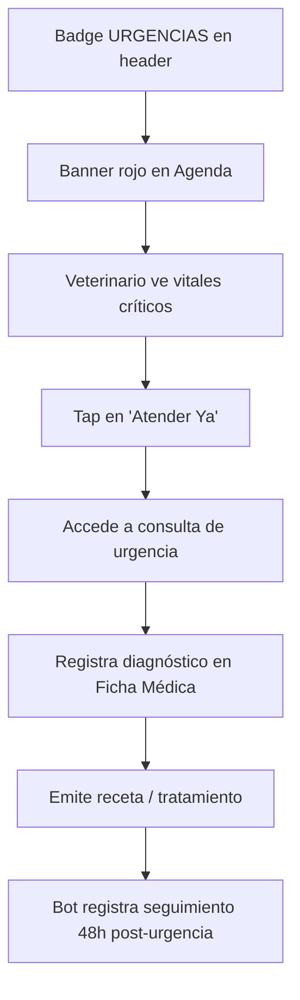
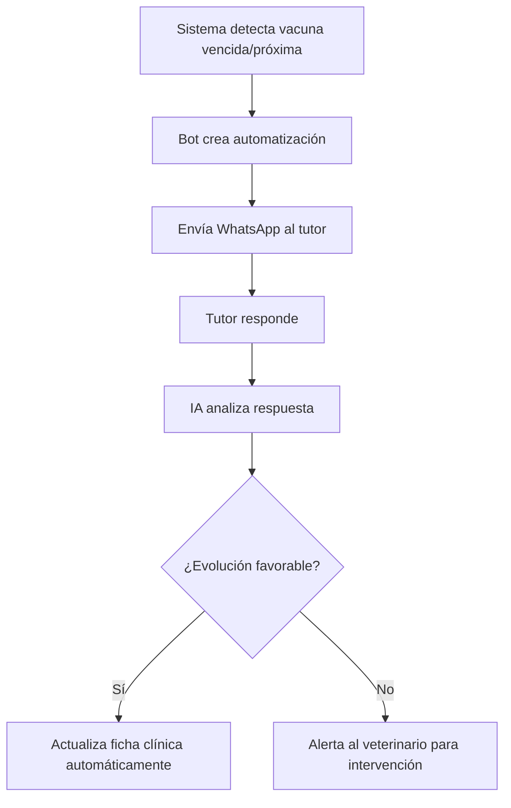
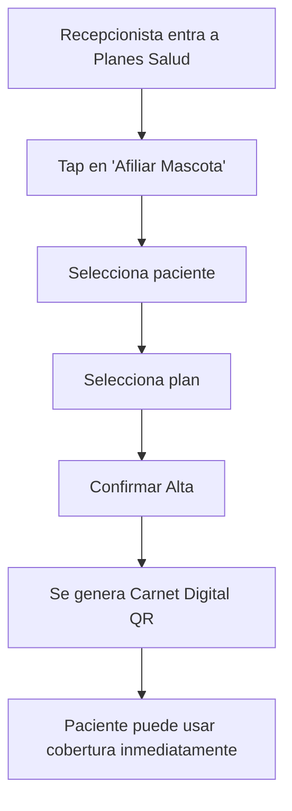

# 📋 Manual de Casos de Uso — VetCare Pro
### Sistema Integral de Gestión Veterinaria

> [!IMPORTANT]
> Este documento describe exhaustivamente **todos los módulos, pantallas, botones y funciones** del sistema VetCare Pro, tal como está diseñado en el prototipo. Debe ser la referencia base durante el desarrollo.

---

## 🏗️ Arquitectura General de la App

```
VetCare Pro (App Móvil)
├── Header Global (fijo en todas las pantallas)
├── Navegación Inferior (Bottom Navigation - 4 tabs)
│   ├── Tab 1: Agenda (Turnos del Veterinario)
│   ├── Tab 2: Pacientes (Ficha Médica / Historial Clínico)
│   ├── Tab 3: Bot & Alertas (Mensajes Automáticos)
│   └── Tab 4: Planes Salud (Coberturas)
└── Sistema de Modales y Toasts
```

---

## 🎨 Sistema de Diseño — "Clinical Empathy & Care"

| Elemento | Valor |
|---|---|
| **Nombre del DS** | Clinical Empathy & Care |
| **Color Primario** | `#00685f` (Esmeralda Médica) |
| **Color Secundario** | `#006398` (Azul Clínico Sereno) |
| **Color Terciario** | `#825100` (Ámbar de Alerta) |
| **Color Error / Urgencia** | `#ba1a1a` (Coral Médico Rojo) |
| **Tipografía** | Plus Jakarta Sans (400 / 600 / 700) |
| **Fondo Base** | `#f8f9ff` (Canvas Estéril) |
| **Radio de Bordes** | `0.5rem` base → `1.5rem` tarjetas |
| **Plataforma** | Mobile-first (4 col.) → Tablet (8 col.) → Desktop (12 col.) |

---

## 🔝 COMPONENTE GLOBAL — Header Fijo

> Presente en **todas las pantallas** de la aplicación.

### Elementos del Header

| Elemento | Tipo | Función |
|---|---|---|
| **Logo VetCare Pro** | Imagen + Texto | Identidad de marca. Muestra el logo y el nombre "VetCare Pro" más el nombre de la sección activa (Agenda / Pacientes / Bot Y Alertas / Planes Salud) |
| **Badge "URGENCIAS"** | Chip de estado (error) | Indicador permanente de acceso rápido a urgencias. Siempre visible. Color rojo `error-container`. Icono de emergencia + texto "URGENCIAS" en mayúsculas |
| **Avatar de Perfil** | Imagen circular | Foto del veterinario logueado (ej: Dra. Valeria). Tiene un punto verde indicador de sesión activa (en línea). Acción: tap abre perfil/configuración de cuenta |

### Casos de Uso del Header

**CU-H-01: Ver indicador de urgencias**
- **Actor:** Veterinario
- **Precondición:** Existe al menos una urgencia activa
- **Flujo:** El badge rojo "URGENCIAS" parpadea visualmente en el header
- **Resultado:** El médico es alertado de forma permanente sin importar en qué pantalla esté

**CU-H-02: Acceder al perfil de usuario**
- **Actor:** Veterinario
- **Flujo:** Tap en el avatar circular del header
- **Resultado:** Abre pantalla de perfil / configuración de cuenta

---

## 📱 NAVEGACIÓN INFERIOR (Bottom Navigation)

> Fija al pie de pantalla, presente en las 4 vistas principales. Usa `backdrop-blur` y efecto de vidrio.

| Tab | Ícono | Label | Ruta |
|---|---|---|---|
| **Agenda** | `calendar_month` | Agenda | `#agenda` |
| **Pacientes** | `pets` | Pacientes | `#pacientes` |
| **Bot & Alertas** | `smart_toy` | Bot & Alertas | `#bot-y-alertas` |
| **Planes Salud** | `health_and_safety` | Planes Salud | `#planes-salud` |

### Estado Activo
- El tab activo se muestra con color `primary` (esmeralda) y texto en negrita
- Los demás tabs muestran color `on-surface-variant` (gris)

### Casos de Uso de Navegación

**CU-NAV-01: Navegar entre módulos principales**
- **Actor:** Veterinario
- **Flujo:** Tap en cualquiera de los 4 tabs de navegación inferior
- **Resultado:** Se carga la vista correspondiente sin recargar la app. El tab seleccionado cambia visualmente a estado activo

---

## 🗓️ MÓDULO 1 — AGENDA / TURNOS DEL VETERINARIO

### 1.1 Sección de Bienvenida (Hero Section)

| Elemento | Tipo | Función |
|---|---|---|
| **Chip de Turno** | Label informativo | Muestra turno y box activo (ej: "Turno Mañana • Box 1") en color `secondary` |
| **Saludo personalizado** | Headline | "¡Hola, Dra. Valeria!" – nombre dinámico del médico logueado |
| **Fecha actual** | Texto + ícono calendario | Muestra la fecha del día (ej: "Jueves, 24 de Octubre") |
| **Botón Notificaciones** | Botón circular (ícono bell) | `id="btnNotif"`. Muestra notificaciones del turno. Tiene un punto rojo animado (`animate-ping`) cuando hay notificaciones pendientes |

**CU-AG-01: Ver notificaciones del turno**
- **Actor:** Veterinario
- **Trigger:** Badge rojo animado visible en el botón de campana
- **Flujo:** Tap en botón `btnNotif`
- **Resultado:** Se despliega panel/modal de notificaciones del turno actual

---

### 1.2 Banner de Urgencia (Alerta Crítica)

> Banner rojo de alta prioridad que aparece cuando hay un paciente en triaje de urgencia esperando. Es el elemento de mayor jerarquía visual en la pantalla.

| Elemento | Tipo | Función |
|---|---|---|
| **Chip "Triaje de Urgencia en Espera"** | Label rojo | Texto en mayúsculas con ícono `warning`. Indica estado de emergencia |
| **Badge de tiempo** | Chip informativo | Muestra hace cuánto llegó el paciente (ej: "Llegó hace 8 min") |
| **Foto del paciente** | Miniatura cuadrada | Imagen del animal en urgencias (Golden Retriever en este caso) |
| **Nombre de especie/raza** | Headline | "Canino Golden Retriever" |
| **Síntoma principal** | Subtítulo | "Dificultad respiratoria aguda • Sala 2" |
| **Vitales críticos** | Texto de datos | SpO2 y temperatura del paciente (ej: "SpO2 89% • Temp 39.4°C") con ícono `ecg_heart` |
| **Botón "Atender Ya"** | CTA rojo primario | Acción más urgente de la pantalla. Redirige al médico a la consulta de urgencias |

**CU-AG-02: Atender paciente de urgencias**
- **Actor:** Veterinario
- **Precondición:** Existe un paciente en triaje de urgencia
- **Flujo:** 
  1. El banner rojo es visible en la parte superior de la Agenda
  2. El veterinario lee los datos vitales del paciente
  3. Tap en botón **"Atender Ya"** (rojo, pill-shaped)
- **Resultado:** Se navega a la ficha de urgencia/atención inmediata del paciente. El tiempo transcurrido se detiene.
- **Postcondición:** El estado del paciente cambia de "Urgencia en Espera" a "En Atención"

---

### 1.3 Panel de Estadísticas del Día

> Tarjeta con 3 métricas en grilla de 3 columnas.

| Métrica | Color | Descripción |
|---|---|---|
| **Citas Hoy** | `primary` (verde) | Total de turnos programados para el día actual |
| **Atendidas** | `secondary` (azul) | Turnos ya completados |
| **Urg. Resuelta** | `tertiary` (ámbar) | Urgencias resueltas en el día |

> Estos valores son solo visualización. No tienen acción de tap en este diseño.

---

### 1.4 Selector de Semana (Week Picker)

| Elemento | Tipo | Función |
|---|---|---|
| **Label "Semana 43"** | Texto | Muestra el número de semana ISO actual |
| **Link "Mes completo"** | Texto navegable + chevron | Acción: navega a la vista de calendario mensual completo |
| **Botones de día** (LUN–DOM) | Botones seleccionables | Cada botón muestra el nombre corto del día + número. El día activo tiene fondo `primary` (verde) y sombra. Los días con citas tienen un punto `secondary` debajo del número |

**CU-AG-03: Seleccionar día del calendario semanal**
- **Actor:** Veterinario
- **Flujo:** Tap en cualquiera de los 7 botones del carrusel de días (LUN-DOM)
- **Resultado:** 
  - El botón del día seleccionado cambia a fondo `primary` con texto blanco
  - Los botones de los demás días vuelven a fondo neutro
  - La lista de turnos/cronograma se filtra para mostrar solo las citas del día seleccionado
- **Nota técnica:** El carrusel es deslizable horizontalmente (`overflow-x-auto`)

**CU-AG-04: Ver calendario mensual completo**
- **Actor:** Veterinario
- **Flujo:** Tap en link "Mes completo" (esquina derecha del selector de semana)
- **Resultado:** Se navega a la vista de calendario mensual (pantalla no incluida en el prototipo actual)

---

### 1.5 Chips de Filtro

> Carrusel horizontal de filtros que permiten segmentar las citas del cronograma.

| Chip | Filtro | Badge de cantidad | Estado por defecto |
|---|---|---|---|
| **Todos** | `all` | Total del día (ej: 8) | Activo (verde) |
| **Confirmados** | `confirmed` | Citas confirmadas (ej: 5) | Inactivo |
| **En Espera** | `waiting` | Pacientes esperando (ej: 2) | Inactivo (con punto ámbar pulsante) |
| **Urgencias** | `urgent` | Urgencias activas (ej: 1) | Inactivo (con punto rojo) |

**CU-AG-05: Filtrar lista de turnos**
- **Actor:** Veterinario
- **Flujo:** 
  1. Tap en cualquier chip de filtro (Todos / Confirmados / En Espera / Urgencias)
  2. El chip seleccionado cambia a fondo `primary` con texto blanco
  3. Los demás chips vuelven al estado neutro
- **Resultado:** La lista del "Cronograma del Día" muestra solo las tarjetas de pacientes que coinciden con el filtro seleccionado. Las tarjetas que no coinciden se ocultan (`display: none`).

---

### 1.6 Cronograma del Día — Tarjetas de Pacientes

> Cada cita es representada por una tarjeta vertical con timeline a la izquierda.

#### Estructura de cada Tarjeta de Paciente

| Sub-elemento | Tipo | Función |
|---|---|---|
| **Hora de cita** | Label (verde/neutral) | Horario del turno (ej: 09:00). Color `primary` para citas activas |
| **Duración estimada** | Texto auxiliar | Duración prevista (ej: "45 min") |
| **Línea de timeline** | Divisor visual | Barra vertical que conecta visualmente las citas cronológicamente |
| **Foto del paciente** | Miniatura cuadrada redondeada | Imagen del animal |
| **Nombre del paciente** | Headline bold | Nombre de la mascota (ej: Thor, Mimi, Rocky, Luna) |
| **Ícono de sexo** | Ícono `male`/`female` | Indica género del animal (azul para macho, terciario para hembra) |
| **Datos de especie** | Subtítulo | Raza, edad y peso (ej: "Golden Retriever • 4 años • 32 kg") |
| **Chip de estado** | Badge pill | Estado de la cita (ver tabla abajo) |
| **Bloque de motivo** | Tarjeta interna | Fondo gris claro. Muestra: ícono del tipo de consulta + nombre del motivo + datos del tutor/sede |

#### Estados de Cita (Chips)

| Estado | Color Fondo | Color Texto | Ícono/Efecto |
|---|---|---|---|
| **En Sala** | `tertiary-fixed` (ámbar claro) | `on-tertiary-fixed` | Punto ámbar `animate-ping` |
| **Confirmado** | `surface-container` (gris suave) | `on-secondary-container` | ✓ check |
| **Pendiente** | `surface-container-high` (gris) | `on-surface-variant` | ⌛ `hourglass_empty` |
| **Urgencia** | `error-container` (rojo suave) | `on-error-container` | ⚠ + ping |

---

### 1.6.1 Tarjeta: Thor (En Sala — Control Cardiológico)

| Botón/Elemento | Función |
|---|---|
| **"Llamar a Consulta"** (verde, primario) | `class="call-patient-btn"`. Envía llamada al box. Dispara el Toast de confirmación de llamada |
| **Botón historial** (ícono `medical_information`) | `aria-label="Historial de Thor"`. Navega a la ficha médica/historial clínico del paciente |
| **Badge "PetCare Platinum"** | Muestra el plan de salud del paciente. Visual informativo |

**CU-AG-06: Llamar a un paciente al consultorio**
- **Actor:** Veterinario
- **Flujo:**
  1. Tap en botón verde **"Llamar a Consulta"** dentro de la tarjeta del paciente (Thor)
  2. El sistema muestra el Toast de llamada con animación de entrada desde arriba
  3. El Toast permanece visible 3.5 segundos y luego desaparece automáticamente
- **Resultado:** Thor y su tutor Carlos Méndez reciben una notificación en pantalla y en la app de que deben ingresar al consultorio. El Toast muestra: *"Llamando a Box 01... Thor & Carlos Méndez han sido notificados por pantalla y app."*
- **Cierre manual:** Botón ✕ dentro del Toast cierra el aviso de forma inmediata

**CU-AG-07: Ver historial clínico desde la agenda**
- **Actor:** Veterinario
- **Flujo:** Tap en botón ícono `medical_information` en la tarjeta del paciente
- **Resultado:** Navega al módulo de Pacientes/Ficha Médica de ese paciente específico (módulo 2)

---

### 1.6.2 Tarjeta: Mimi (Confirmada — Vacunación)

| Botón/Elemento | Función |
|---|---|
| **"Preparar Ficha"** | Botón secundario gris. Abre la ficha clínica para pre-completarla antes de la consulta |
| **Badge "Al día"** | Indicador verde. Visual que confirma que las vacunas del paciente están vigentes |

**CU-AG-08: Preparar ficha antes de consulta**
- **Actor:** Veterinario
- **Flujo:** Tap en botón **"Preparar Ficha"** en la tarjeta de Mimi
- **Resultado:** Abre el formulario/ficha clínica de Mimi en modo edición pre-consulta

---

### 1.6.3 Tarjeta: Rocky (Confirmada — Post-quirúrgico)

| Botón/Elemento | Función |
|---|---|
| **"Ver Placas RX"** | Botón secundario con ícono `radiology`. Abre el visor de radiografías del paciente |
| **Badge "Día 14 post-op"** | Informativo. Muestra el día de evolución post-operatoria |

**CU-AG-09: Ver radiografías del paciente**
- **Actor:** Veterinario
- **Flujo:** Tap en **"Ver Placas RX"** en la tarjeta de Rocky
- **Resultado:** Abre el visor de imágenes radiológicas del paciente (Rocky, revisión posquirúrgica de rodilla)

---

### 1.6.4 Tarjeta: Luna (Pendiente — Limpieza Dental)

| Botón/Elemento | Función |
|---|---|
| **"Reenviar WhatsApp"** | Botón texto azul con ícono `chat`. Reenvía el mensaje recordatorio de turno al tutor por WhatsApp |
| **"Gestionar"** | Botón gris neutro. Abre el panel de gestión del turno (editar, cancelar, reprogramar, confirmar) |
| **Info "Recordatorio enviado"** | Texto con ícono `call`. Indica que ya se envió un recordatorio automático |
| **Info "Ayuno requerido"** | Texto informativo. Instrucción previa para el procedimiento |

**CU-AG-10: Reenviar recordatorio por WhatsApp**
- **Actor:** Veterinario o recepcionista
- **Flujo:** Tap en **"Reenviar WhatsApp"** en la tarjeta de Luna
- **Resultado:** Se dispara el envío del mensaje de recordatorio de turno por WhatsApp al tutor. Se actualiza el estado del recordatorio.

**CU-AG-11: Gestionar turno pendiente**
- **Actor:** Veterinario o recepcionista
- **Flujo:** Tap en **"Gestionar"** en la tarjeta de Luna
- **Resultado:** Abre bottom sheet o modal con opciones: Confirmar / Cancelar / Reprogramar / Ver Detalles

---

### 1.7 Banner del Bot Asistente

> Tarjeta informativa con acceso al módulo de Bot.

| Elemento | Función |
|---|---|
| **Ícono `smart_toy`** | Visual del bot en círculo `primary-fixed` |
| **"Bot Asistente VetCare"** | Nombre del bot |
| **"Confirmó 4 turnos automáticamente hoy"** | Texto informativo de actividad reciente del bot |
| **Chevron `chevron_right`** | Indica que es clickeable. Navega al módulo de Bot & Alertas |

**CU-AG-12: Acceder al Bot desde la Agenda**
- **Actor:** Veterinario
- **Flujo:** Tap en la tarjeta del Bot Asistente
- **Resultado:** Navega al módulo "Bot & Alertas" (Tab 3)

---

### 1.8 Botón Flotante — Nuevo Turno

| Elemento | Función |
|---|---|
| **"+ Nuevo Turno / Ingreso Rápido"** | FAB (Floating Action Button) verde ancho. `id="btnNewAppointment"`. Permite crear un nuevo turno o registrar un ingreso rápido sin turno previo |

**CU-AG-13: Crear nuevo turno o ingreso rápido**
- **Actor:** Veterinario o recepcionista
- **Flujo:** Tap en el botón verde **"+ Nuevo Turno / Ingreso Rápido"** (sticky al scroll)
- **Resultado:** Abre formulario/modal de creación de turno con campos: especie, tutor, fecha/hora, motivo, duración estimada, box asignado

---

### 1.9 Toast de Llamada (Componente global de la Agenda)

> Panel de notificación temporal que aparece desde arriba al llamar a un paciente.

| Elemento | Función |
|---|---|
| **Ícono `ring_volume`** en círculo | Visual de llamada activa |
| **"Llamando a Box 01..."** | Texto principal del toast |
| **Nombre y tutor** | Confirmación de quién fue notificado |
| **Botón ✕** (`id="closeToast"`) | Cierra el toast manualmente |

> El toast desaparece automáticamente a los 3.5 segundos.

---

## 🐾 MÓDULO 2 — PACIENTES / FICHA MÉDICA E HISTORIAL CLÍNICO

### 2.1 Barra de Acciones Superior (Breadcrumb)

| Botón | Ícono | Función |
|---|---|---|
| **← Pacientes** | `arrow_back` | Regresa al listado de pacientes |
| **Compartir** | `share` | Comparte la ficha del paciente (PDF / link) |
| **Imprimir** | `print` | Imprime la ficha médica del paciente |
| **Más opciones** | `more_vert` (3 puntos verticales) | Despliega menú adicional: editar, archivar, eliminar, etc. |

**CU-PA-01: Volver al listado de pacientes**
- **Flujo:** Tap en "← Pacientes"
- **Resultado:** Regresa a la pantalla de listado/búsqueda de pacientes

**CU-PA-02: Compartir ficha médica**
- **Flujo:** Tap en ícono `share`
- **Resultado:** Abre el menú nativo del sistema operativo para compartir (WhatsApp, email, PDF, etc.)

**CU-PA-03: Imprimir ficha médica**
- **Flujo:** Tap en ícono `print`
- **Resultado:** Envía la ficha al sistema de impresión o genera un PDF imprimible

---

### 2.2 Tarjeta de Perfil Principal del Paciente

#### Encabezado del Paciente (Thor)

| Elemento | Función |
|---|---|
| **Foto del paciente** | Imagen grande (80x80 px, redondeada). Badge verde de "Paciente Activo" superpuesto |
| **Nombre: "Thor"** | Headline XL del paciente |
| **Badge "Activo"** | Chip azul claro. Estado del paciente en la clínica |
| **"Canino · Golden Retriever"** | Especie y raza en color `primary` |
| **"Macho · 4a 2m"** | Chip de sexo y edad |
| **"32.4 kg (↑ 0.5kg)"** | Chip de peso con indicador de tendencia (aumento) |

#### Vitales Rápidos (Grilla 2 columnas)

| Elemento | Contenido | Función |
|---|---|---|
| **Grupo Sanguíneo** | "DEA 1.1 Positivo" | Dato clínico crítico. Fondo rojizo |
| **Microchip ID** | "...94812" | Identificador del chip RFID. Visible truncado por seguridad |

#### Banner de Plan de Salud

| Elemento | Función |
|---|---|
| **"PetCare Platinum Activo"** | Muestra el plan de salud vigente del paciente |
| **Chevron →** | Navega al módulo de Planes de Salud de este paciente |

**CU-PA-04: Ver plan de salud desde la ficha**
- **Flujo:** Tap en el banner del plan "PetCare Platinum Activo"
- **Resultado:** Navega al Módulo 4 (Planes Salud), con el contexto del paciente pre-cargado

---

### 2.3 Módulo de Contacto del Responsable Legal

| Elemento | Función |
|---|---|
| **Foto del tutor** | Imagen circular del responsable legal (Carlos Méndez) |
| **Nombre del tutor** | "Carlos Méndez" — Nombre completo |
| **Dirección** | "Av. Libertador 2420, CABA" — Dirección del domicilio |
| **Botón 📞 Llamar** | `href="tel:+5491148291122"`. Inicia llamada telefónica directa al tutor |
| **Botón 💬 WhatsApp** | `href="https://wa.me/..."`. Abre conversación de WhatsApp con el tutor |

**CU-PA-05: Llamar al tutor del paciente**
- **Flujo:** Tap en botón verde ☎
- **Resultado:** Abre el marcador telefónico del dispositivo con el número del tutor pre-cargado

**CU-PA-06: Enviar WhatsApp al tutor**
- **Flujo:** Tap en botón de chat
- **Resultado:** Abre WhatsApp (o WhatsApp Web) con la conversación del tutor

---

### 2.4 Bloque de Constantes Vitales de Base

> Grilla de 3 columnas con las constantes vitales registradas en la última consulta.

| Vital | Valor | Estado |
|---|---|---|
| **FC (lpm)** — Frecuencia Cardíaca | 88 | ✓ Normal |
| **FR (rpm)** — Frecuencia Respiratoria | 24 | ✓ Normal |
| **Temp (°C)** — Temperatura | 38.6 | ✓ Óptima |

> La fecha del registro es visible ("18/09/2024"). Elemento informativo, sin acciones de tap.

---

### 2.5 Sección Colapsable: Historial de Vacunación

> Tarjeta expandible. Por defecto: **expandida**.

**Encabezado colapsable:** Ícono `vaccines` + "Historial de Vacunación" + "2 al día · 1 pendiente" + ícono `expand_more`/`chevron_right`

**CU-PA-07: Expandir/Colapsar sección de vacunas**
- **Flujo:** Tap en el encabezado de la sección (clickeable: `onclick="toggleSection()"`)
- **Resultado:** 
  - Si estaba abierta → se cierra (el ícono rota a `chevron_right`)
  - Si estaba cerrada → se abre (el ícono rota a `expand_more`)

#### Lista de Vacunas (dentro de la sección)

| Vacuna | Estado | Aplicada | Vence |
|---|---|---|---|
| **Rabia (Rabisin)** | ✓ Al día | 15/05/2024 | 15/05/2025 |
| **Óctuple Canina** | ✓ Al día | 10/01/2024 | 10/01/2025 |
| **Giardia** | ⚠ Refuerzo pendiente (pulsante) | 15/09/2023 | Venció: 15/09/2024 |

| Botón | Función |
|---|---|
| **"+ Registrar Vacuna"** | Botón verde outline. Abre formulario para registrar una nueva vacuna aplicada al paciente |

**CU-PA-08: Registrar nueva vacuna**
- **Actor:** Veterinario
- **Flujo:** Tap en **"+ Registrar Vacuna"** dentro de la sección de vacunas
- **Resultado:** Abre formulario con campos: nombre de vacuna, lote, fecha de aplicación, fecha de vencimiento, veterinario que aplicó, dosis

---

### 2.6 Sección Colapsable: Cirugías & Procedimientos

> Tarjeta expandible. Por defecto: **colapsada**.

**Encabezado:** Ícono `medical_services` + "Cirugías & Procedimientos" + "2 antecedentes quirúrgicos"

**CU-PA-09: Expandir historial quirúrgico**
- **Flujo:** Tap en el encabezado de la sección
- **Resultado:** Se despliega la lista de procedimientos quirúrgicos previos

#### Lista de Procedimientos

| Procedimiento | Fecha | Sede | Resultado |
|---|---|---|---|
| Castración programada | 12/08/2021 | Clínica San Isidro | Sin complicaciones |
| Sutura herida en almohadilla | 03/03/2023 | Sede Central | Alta médica |

> No hay botones de acción dentro de esta sección en el diseño actual.

---

### 2.7 Sección Colapsable: Consultas y Tratamientos

> Tarjeta expandible. Por defecto: **colapsada**.

**Encabezado:** Ícono `clinical_notes` + "Consultas y Tratamientos" + "Historial ambulatorio"

**CU-PA-10: Ver historial de consultas**
- **Flujo:** Tap en el encabezado
- **Resultado:** Lista de consultas ambulatorias previas

#### Entrada de Consulta (Ejemplo)

| Elemento | Contenido |
|---|---|
| **Diagnóstico** | "Otitis externa leve" |
| **Fecha y médico** | 18/09/2024 · Dra. Valeria Gómez |
| **Estado** | ✓ Recuperado |
| **Tratamiento** | Gotas óticas antiinflamatorias/antibióticas. 12 horas, 7 días. Limpieza previa. |
| **Sede** | Sucursal Norte |

| Botón | Función |
|---|---|
| **"Ver Receta PDF →"** | Texto azul con flecha. Descarga/abre el documento PDF de la receta médica asociada a esa consulta |

**CU-PA-11: Ver receta en PDF**
- **Flujo:** Tap en "Ver Receta PDF →"
- **Resultado:** Abre o descarga el PDF de la receta digital del tratamiento registrado

---

### 2.8 Botón Principal de Acción Clínica

| Botón | Función |
|---|---|
| **"+ Nueva Entrada Clínica / Receta Digital"** | Botón verde grande ancho (h-12). `onclick="triggerNewClinicalEntry()"`. Inicia una nueva consulta y/o emite una receta digital para el paciente |

**CU-PA-12: Iniciar nueva consulta / receta digital**
- **Actor:** Veterinario
- **Flujo:**
  1. Tap en botón verde **"+ Nueva Entrada Clínica / Receta Digital"**
  2. Aparece Toast oscuro desde abajo: *"Iniciando consulta para Thor..."*
  3. El Toast desaparece a los 2.8 segundos
- **Resultado:** Abre el formulario de nueva consulta/receta con el paciente (Thor) pre-seleccionado
- **Nota de seguridad:** Debajo del botón aparece el texto: *"Expediente Médico Protegido · Sincronizado en tiempo real"* con ícono de candado

---

## 🤖 MÓDULO 3 — BOT & MENSAJES AUTOMÁTICOS

### 3.1 Panel de Estado del Bot (Banner Principal)

| Elemento | Tipo | Función |
|---|---|---|
| **Ícono `smart_toy`** | Avatar del bot con badge verde animado (ping) | Indica que el bot está activo y conectado en tiempo real |
| **"VetBot Asistente"** | Headline | Nombre del asistente automático |
| **Badge "ACTIVO"** | Pill verde | Estado operativo del bot |
| **"Conectado a WhatsApp Business API oficial"** | Subtítulo | Muestra el canal principal de comunicación |
| **Toggle Switch Global** | `id="botToggle"` — Checkbox estilizado | **Activa/Desactiva el bot completo**. Al desactivar, el badge cambia a "EN PAUSA" (gris) |

**CU-BOT-01: Activar/Desactivar el VetBot**
- **Actor:** Veterinario o administrador
- **Flujo:** 
  1. Tap en el toggle switch del banner del bot
  2. Si estaba Activo → pasa a "En Pausa". El badge cambia a gris con texto "EN PAUSA"
  3. Si estaba En Pausa → pasa a "Activo". El badge vuelve a verde con texto "ACTIVO"
- **Resultado:** El bot deja de enviar mensajes automáticos (o los reanuda) para todos los pacientes
- **Impacto:** Todos los envíos programados quedan en pausa hasta que se reactive

---

### 3.2 Barra de Canales Activos

> Carrusel horizontal de indicadores de canal.

| Canal | Ícono | Estado |
|---|---|---|
| **WhatsApp** | `chat` | 🟢 Activo (punto verde) |
| **SMS Backup** | `sms` | 🔵 Activo (punto azul) |
| **Email** | `alternate_email` | ⚪ Secundario (punto gris) |

> Estos indicadores son informativos del estado de cada canal de despacho.

---

### 3.3 Panel de Métricas de Rendimiento

> Grilla de 3 tarjetas con KPIs del bot.

| Métrica | Ícono | Valor | Descripción |
|---|---|---|---|
| **Enviados este mes** | `forward_to_inbox` | 142 | Total de mensajes despachados |
| **Citas confirmadas** | `verified` | 94% | Tasa de confirmación automática |
| **Vacunas rescatadas** | `autorenew` | 28 | Alertas de vacunas vencidas que se reagendaron |

> Solo visualización. Sin acciones de tap.

---

### 3.4 Botones de Acción Principal

| Botón | Función |
|---|---|
| **"+ Nueva Regla"** | Botón verde primario. Crea una nueva regla de automatización del bot (trigger + mensaje + canal + timing) |
| **"Simular Test"** | Botón blanco secundario con ícono `send`. `onclick="triggerTestSimulation()"`. Envía un mensaje de prueba para verificar el flujo del bot |

**CU-BOT-02: Crear nueva regla de automatización**
- **Actor:** Veterinario o administrador
- **Flujo:** Tap en **"+ Nueva Regla"**
- **Resultado:** Abre formulario de creación de regla con campos: Tipo de trigger (vacuna vencida / cita próxima / post-cirugía / etc.), mensaje personalizable, canal de envío, timing (24h antes / inmediato / +365 días), pacientes objetivo

**CU-BOT-03: Simular envío de mensaje de prueba**
- **Actor:** Veterinario
- **Flujo:** Tap en **"Simular Test"**
- **Resultado:** 
  1. Aparece Toast oscuro desde arriba: *"Mensaje de prueba enviado — Revisá el WhatsApp registrado para ver la interacción."*
  2. El Toast desaparece automáticamente a los 3.2 segundos
- **Precondición:** El bot debe estar configurado con al menos una regla activa

---

### 3.5 Chips de Filtro de Automatizaciones

> Carrusel horizontal para filtrar el flujo de mensajes por categoría.

| Chip | Filtro |
|---|---|
| **Todos (24)** | Muestra todas las automatizaciones activas |
| **Vacunación** | Solo mensajes de recordatorio de vacunas |
| **Control Posquirúrgico** | Solo seguimientos post-operatorios |
| **Desparasitación** | Solo alertas de desparasitación |
| **Turnos Próximos** | Solo recordatorios de turnos |

**CU-BOT-04: Filtrar automatizaciones por categoría**
- **Flujo:** Tap en cualquier chip de filtro
- **Resultado:** La lista de automatizaciones del "Flujo en Tiempo Real" se filtra por la categoría seleccionada

---

### 3.6 Lista de Automatizaciones en Tiempo Real

#### Item 1: Vacunación Giardia (Thor / Carlos Méndez)

| Elemento | Función |
|---|---|
| **Ícono `vaccines`** | Categoría del mensaje |
| **"Vacunación Giardia"** | Nombre de la automatización |
| **"Carlos Méndez · Thor (Golden Retriever)"** | Destinatario y paciente |
| **Badge "Programado"** (ámbar) | Estado del envío: pendiente de enviar |
| **"Mañana 09:00 hs por WhatsApp Business"** | Horario y canal de despacho |
| **Vista previa del mensaje** | Burbuja de chat que muestra el texto real que recibirá el tutor |
| **"Bot Trigger: Calendario +365d"** | Regla que disparó el mensaje (anual) |
| **Botón "Editar Texto"** | Modifica el contenido del mensaje antes de enviarlo |
| **Botón "Enviar Ahora"** | Envía el mensaje inmediatamente sin esperar la programación |

**CU-BOT-05: Editar texto de un mensaje programado**
- **Flujo:** Tap en **"Editar Texto"** del ítem de automatización
- **Resultado:** Abre editor de texto del mensaje con el contenido actual pre-cargado. Permite personalizar el texto antes del envío programado.

**CU-BOT-06: Enviar mensaje automático de forma inmediata**
- **Flujo:** Tap en **"Enviar Ahora"**
- **Resultado:** El mensaje se despacha al instante a través del canal configurado (WhatsApp). El estado del ítem cambia de "Programado" a "Enviado [hora]"

---

#### Item 2: Seguimiento 48h Castración (Lucas / María Elena)

| Elemento | Función |
|---|---|
| **Badge "Enviado 10:30 hs"** (verde) | Estado: ya fue enviado |
| **Panel "Respuesta Analizada por IA"** | El bot analizó la respuesta del tutor con IA |
| **Badge "Evolución Favorable"** | Clasificación automática del estado del paciente según la respuesta |
| **Texto de respuesta del tutor** | Muestra la respuesta textual: *"Está comiendo bien y sin dolor 👍 Ya jugó un ratito..."* |
| **"Ficha clínica actualizada"** | Confirmación de que la IA actualizó automáticamente el historial |
| **"Ver Chat →"** | Link azul. Abre la conversación completa de WhatsApp con el tutor |

**CU-BOT-07: Ver chat de seguimiento con el tutor**
- **Flujo:** Tap en "Ver Chat →"
- **Resultado:** Abre el hilo completo de conversación de WhatsApp Business con María Elena sobre la evolución de Lucas

---

#### Item 3: Recordatorio Cita 24h (Mimi / Sofía Lara)

| Elemento | Función |
|---|---|
| **Badge "Confirmada"** (azul con ✓) | La tutora confirmó el turno a través del bot |
| **"Turno mañana a las 16:30 hs"** | Detalle del turno confirmado |
| **"Entregado"** | Estado del mensaje: recibido por el destinatario |

> Ítem de solo lectura. Sin acciones.

---

#### Item 4: Antiparasitario Trimestral (Campaña masiva)

| Elemento | Función |
|---|---|
| **Badge "Lote Automático"** | Es un envío masivo a múltiples pacientes |
| **"18 envíos programados"** | Cantidad de mensajes en la cola |
| **"Pacientes con dosis vencida esta semana"** | Criterio del lote |
| **Botón "Ver Lote →"** | Abre el detalle del lote masivo con todos los destinatarios y sus estados |

**CU-BOT-08: Ver detalle de lote masivo**
- **Flujo:** Tap en **"Ver Lote →"**
- **Resultado:** Abre la lista completa de los 18 pacientes del lote con nombre, tutor, estado del envío individual y posibilidad de excluir o pausar un paciente específico

---

### 3.7 Configuración de Canales de Despacho

> Tarjeta al pie de la pantalla con toggles/checkboxes de canales.

| Canal | Descripción | Estado por defecto |
|---|---|---|
| **WhatsApp Cloud API** | Canal primario de alta tasa de lectura | ✅ Activado |
| **SMS Respaldo (Backup)** | Se envía si WhatsApp falla tras 15 min | ✅ Activado |
| **Correo Electrónico** | Resumen mensual e historial de vacunas | ☐ Desactivado |

**CU-BOT-09: Activar/Desactivar canal de comunicación**
- **Flujo:** Tap en el checkbox de cualquier canal
- **Resultado:** El canal se activa o desactiva. Los mensajes futuros usan/excluyen ese canal según la jerarquía de prioridad configurada

---

## 🏥 MÓDULO 4 — PLANES DE SALUD / COBERTURAS

### 4.1 Encabezado de Sección

| Elemento | Función |
|---|---|
| **Chip "Cobertura Médica & Obra Social"** | Etiqueta de categoría con ícono `verified` |
| **Título "Medicina Prepaga & Planes Sanitarios"** | Headline principal del módulo |
| **Descripción** | "Gestión clínica integral de beneficios sanitarios, seguimiento de consumos preventivos y credenciales digitales." |

---

### 4.2 Switcher de Vistas (Tab Interno)

> Selector de 2 pestañas dentro del módulo.

| Tab | Ícono | Función |
|---|---|---|
| **Suscripción Activa** | `verified_user` | Muestra la cobertura vigente del paciente seleccionado |
| **Catálogo de Planes** | `view_carousel` | Muestra todos los planes disponibles para contratar |

**CU-PS-01: Cambiar entre Suscripción Activa y Catálogo**
- **Flujo:** Tap en cualquiera de los 2 tabs internos
- **Resultado:** 
  - Tab activo → fondo blanco con sombra, texto `primary`
  - Tab inactivo → fondo transparente, texto gris
  - Se muestra/oculta la vista correspondiente con animación de transición

---

### 4.3 Botones de Acción Rápida (Grilla 2 columnas)

| Botón | Ícono | Función |
|---|---|---|
| **"Validar DNI / Chip"** | `qr_code_scanner` | `onclick="openModal('validate')"`. Abre modal para validar cobertura por DNI o microchip RFID |
| **"Afiliar Mascota"** | `add_circle` | `onclick="openModal('affiliate')"`. Abre modal para afiliar un nuevo paciente a un plan de salud |

**CU-PS-02: Validar cobertura de un paciente**
- **Actor:** Recepcionista o veterinario
- **Flujo:**
  1. Tap en **"Validar DNI / Chip"**
  2. Se abre el Modal de Validación (bottom sheet desde abajo)
  3. Ingresar número de DNI del titular **o** número de microchip, **o** aproximar el chip RFID al lector NFC
  4. Tap en **"Buscar"** dentro del modal
- **Resultado:** El sistema verifica la cobertura y muestra el plan activo del paciente con sus beneficios vigentes
- **Cierre:** Botón ✕ en la esquina del modal

**CU-PS-03: Afiliar mascota a plan de salud**
- **Actor:** Recepcionista o veterinario
- **Flujo:**
  1. Tap en **"Afiliar Mascota"**
  2. Se abre el Modal de Afiliación
  3. Seleccionar paciente del listado desplegable
  4. Seleccionar plan (Esencial / Platinum / Senior) — botones de selección visual
  5. Tap en **"Confirmar Alta & Emitir Carnet"**
- **Resultado:** El paciente queda afiliado al plan seleccionado y se genera automáticamente el carnet digital QR (VetCare Pass)

---

### 4.4 VISTA 1: Suscripción Activa (Thor — PetCare Platinum)

#### 4.4.1 Header del Paciente Activo

| Elemento | Función |
|---|---|
| **Foto de Thor** | Miniatura circular con punto verde de "activo" |
| **"Thor"** + Badge "Canino" | Nombre y especie del paciente |
| **"Golden Retriever · 4 años · Chip #9810-AR"** | Datos identificatorios |
| **"Titular: Lic. Martín Albarracín"** | Responsable legal del plan |
| **Botón `swap_horiz`** | Cambia el paciente visualizado (si hay varios asociados al tutor) |

**CU-PS-04: Cambiar paciente activo**
- **Flujo:** Tap en botón `swap_horiz` (intercambio)
- **Resultado:** Abre selector de pacientes asociados al mismo titular para cambiar la vista de cobertura

---

#### 4.4.2 Tarjeta VIP "PetCare Platinum"

> Tarjeta de membresía estilo "tarjeta de crédito" con gradiente verde esmeralda. Alto impacto visual.

| Elemento | Función |
|---|---|
| **⭐ "PetCare Platinum"** | Nombre del plan con ícono dorado |
| **Badge "VIP Care"** | Categoría del plan |
| **Punto verde animado** | Indica que la cuota está al día |
| **"Afiliado Activo · Cuota al día"** | Estado de pago |
| **"$ 24.500 / mes (Débito Automático)"** | Monto y modalidad de pago |
| **"Próxima facturación: 05 de Noviembre, 2025"** | Fecha del próximo cobro |
| **Botón "Carnet Digital" (`qr_code_2`)** | `onclick="toggleQRModal()"`. Abre el modal del Carnet Digital QR |

**CU-PS-05: Ver Carnet Digital (QR Pass)**
- **Flujo:** Tap en **"Carnet Digital"**
- **Resultado:** Se abre el Modal del QR (overlay con blur). Muestra:
  - Título: "Carnet Digital · VetCare Pass"
  - Código QR visual (SVG con ID: VC-THOR-9810-PLAT)
  - Instrucción de uso en sedes hospitalarias

**Botones dentro del Modal QR:**

| Botón | Función |
|---|---|
| **"Cerrar"** | `onclick="toggleQRModal()"`. Cierra el modal sin acción |
| **"Guardar Pass"** | `id="share-btn"`. `onclick="copyCardId()"`. Descarga/guarda el carnet en la wallet digital. Cambia temporalmente a "Guardado en Wallet" con ícono ✓, luego cierra el modal |

---

#### 4.4.3 Coberturas del Ejercicio 2025

> Lista de coberturas detalladas con barra de progreso de consumo.

| Cobertura | Cobertura | Uso / Límite | Barra de Progreso |
|---|---|---|---|
| **Consultas Clínicas Generales** | 100% Cubierto | 4 consultas realizadas | 40% usado |
| **Vacunas Calendario Obligatorio** | 100% Bonificado | 2 de 3 aplicadas | 66.6% |
| **Cirugías Menores & Anestesia** | 40% OFF | Sin consumos en 2025 | — |
| **Profilaxis Dental por Ultrasonido** | 1 Anual Gratis | Disponible | — |
| **Urgencias y Triage 24/7** | 100% Cubierto | Ilimitado | — |

| Botón | Función |
|---|---|
| **"Reservar Turno"** (en Profilaxis Dental) | Atajo para agendar la limpieza dental gratuita incluida en el plan |

**CU-PS-06: Reservar turno de beneficio del plan**
- **Flujo:** Tap en **"Reservar Turno"** dentro de la cobertura de Profilaxis Dental
- **Resultado:** Redirige al módulo de Agenda para crear un turno de limpieza dental, con la información del plan pre-cargada (sin costo para el paciente)

#### Tarjeta de Ahorro Acumulado

| Elemento | Función |
|---|---|
| **"Ahorro Preventivo Acumulado"** | Resumen financiero del beneficio del plan |
| **Texto informativo** | "El plan Platinum le ha bonificado a Thor un total estimado de **$ 58.200** en tratamientos y vacunas." |

> Solo informativo. Sin acciones.

---

### 4.5 VISTA 2: Catálogo de Planes Disponibles

> Visible al seleccionar el tab "Catálogo de Planes".

#### Plan Esencial ($12.900/mes)

| Elemento | Función |
|---|---|
| **"Plan Esencial"** | Nombre del plan |
| **"Protección básica y medicina preventiva"** | Descripción |
| **$ 12.900/mes** | Precio |
| **Lista de beneficios** (✓ checkmarks) | - Consultas hasta 6/año al 100% · Vacunación anual · 15% descuento farmacia |
| **"Ver Detalle de Prestaciones"** | Botón gris. Abre el detalle completo de coberturas del plan |

**CU-PS-07: Ver detalle de un plan**
- **Flujo:** Tap en **"Ver Detalle de Prestaciones"**
- **Resultado:** Abre pantalla/modal con todas las prestaciones incluidas, exclusiones y condiciones generales del plan

---

#### Plan Platinum ($24.500/mes) — Plan de Thor

| Elemento | Función |
|---|---|
| **Badge "Plan de Thor · Más Elegido"** | Destaca que es el plan activo del paciente y el más popular |
| **"Cobertura Integral"** | Categoría del plan |
| **Lista de beneficios** | Consultas ilimitadas · 40% cirugías · Dental gratis · 50% estudios |
| **"Comparar Coberturas"** | Botón gris. Abre comparativa side-by-side entre planes |
| **Botón `share`** (verde) | Comparte la información del plan (WhatsApp, email, PDF) |

**CU-PS-08: Comparar planes**
- **Flujo:** Tap en **"Comparar Coberturas"**
- **Resultado:** Abre tabla comparativa de todos los planes disponibles con todas sus coberturas detalladas

**CU-PS-09: Compartir información de un plan**
- **Flujo:** Tap en botón `share` del Plan Platinum
- **Resultado:** Abre el menú nativo de compartir del sistema operativo para enviar la info del plan

---

#### Plan Senior (+7 años) ($28.900/mes)

| Elemento | Función |
|---|---|
| **"Plan Senior"** + Badge "+7 Años" | Nombre y requisito de edad |
| **Lista de beneficios** | Chequeos geriátricos · Ecografías · Medicación crónica 30% off |
| **"Cambiar a Plan Senior"** | `onclick="openModal('affiliate-senior')"`. Inicia el proceso de cambio de plan del paciente actual al Plan Senior |

**CU-PS-10: Cambiar al Plan Senior**
- **Flujo:** Tap en **"Cambiar a Plan Senior"**
- **Precondición:** El paciente debe tener 7 años o más para calificar
- **Resultado:** Abre el modal de afiliación pre-configurado para el Plan Senior, mostrando el proceso de portabilidad desde el plan actual

---

### 4.6 Banda de Confianza / Red Propia

| Elemento | Función |
|---|---|
| **Ícono `health_and_safety`** | Visual de salud y seguridad |
| **"Red Veterinaria Propia VetCare"** | Nombre de la red |
| **Descripción** | "Atención directa sin reintegros ni autorizaciones demoradas. Acceso directo a quirófano y laboratorio central." |

> Solo informativo. Sin acciones.

---

### 4.7 Modales del Módulo de Planes

#### Modal de Validación (DNI / Chip)

| Elemento | Función |
|---|---|
| **Campo de texto** | Ingreso de número de microchip o DNI del titular |
| **Botón "Buscar"** | Ejecuta la búsqueda de cobertura |
| **Lector NFC/RFID** | Área visual que indica que el lector está listo para aproximación del chip |

#### Modal de Afiliación

| Elemento | Función |
|---|---|
| **Select de paciente** | Dropdown con pacientes registrados disponibles |
| **Selector de plan** | Botones de selección visual (Esencial / Platinum / Senior) |
| **"Confirmar Alta & Emitir Carnet"** | Finaliza la afiliación y genera el QR pass digital |
| **Botón ✕** | `onclick="closeActionModal()"`. Cierra el modal sin guardar |

---

## 🔄 FLUJOS TRANSVERSALES Y CASOS DE USO GLOBALES

### Flujo de Urgencia (Multi-módulo)



### Flujo de Recordatorio Automático (Bot)



### Flujo de Alta a Plan de Salud



---

## 📊 RESUMEN DE CASOS DE USO POR MÓDULO

| ID | Caso de Uso | Módulo | Actor Principal |
|---|---|---|---|
| CU-H-01 | Ver indicador de urgencias | Header Global | Veterinario |
| CU-H-02 | Acceder al perfil de usuario | Header Global | Veterinario |
| CU-NAV-01 | Navegar entre módulos | Navegación | Veterinario |
| CU-AG-01 | Ver notificaciones del turno | Agenda | Veterinario |
| CU-AG-02 | Atender paciente de urgencias | Agenda | Veterinario |
| CU-AG-03 | Seleccionar día del calendario | Agenda | Veterinario |
| CU-AG-04 | Ver calendario mensual | Agenda | Veterinario |
| CU-AG-05 | Filtrar lista de turnos | Agenda | Veterinario |
| CU-AG-06 | Llamar paciente al consultorio | Agenda | Veterinario |
| CU-AG-07 | Ver historial desde agenda | Agenda | Veterinario |
| CU-AG-08 | Preparar ficha pre-consulta | Agenda | Veterinario |
| CU-AG-09 | Ver radiografías del paciente | Agenda | Veterinario |
| CU-AG-10 | Reenviar recordatorio WhatsApp | Agenda | Recepcionista |
| CU-AG-11 | Gestionar turno pendiente | Agenda | Recepcionista |
| CU-AG-12 | Acceder al Bot desde Agenda | Agenda | Veterinario |
| CU-AG-13 | Crear nuevo turno/ingreso | Agenda | Recepcionista |
| CU-PA-01 | Volver al listado de pacientes | Pacientes | Veterinario |
| CU-PA-02 | Compartir ficha médica | Pacientes | Veterinario |
| CU-PA-03 | Imprimir ficha médica | Pacientes | Veterinario |
| CU-PA-04 | Ver plan de salud desde ficha | Pacientes | Veterinario |
| CU-PA-05 | Llamar al tutor | Pacientes | Veterinario |
| CU-PA-06 | Enviar WhatsApp al tutor | Pacientes | Veterinario |
| CU-PA-07 | Expandir/colapsar sección vacunas | Pacientes | Veterinario |
| CU-PA-08 | Registrar nueva vacuna | Pacientes | Veterinario |
| CU-PA-09 | Expandir historial quirúrgico | Pacientes | Veterinario |
| CU-PA-10 | Ver historial de consultas | Pacientes | Veterinario |
| CU-PA-11 | Ver receta en PDF | Pacientes | Veterinario |
| CU-PA-12 | Iniciar nueva consulta/receta | Pacientes | Veterinario |
| CU-BOT-01 | Activar/Desactivar VetBot | Bot & Alertas | Administrador |
| CU-BOT-02 | Crear nueva regla | Bot & Alertas | Administrador |
| CU-BOT-03 | Simular envío de prueba | Bot & Alertas | Veterinario |
| CU-BOT-04 | Filtrar automatizaciones | Bot & Alertas | Veterinario |
| CU-BOT-05 | Editar texto de mensaje | Bot & Alertas | Veterinario |
| CU-BOT-06 | Enviar mensaje inmediatamente | Bot & Alertas | Veterinario |
| CU-BOT-07 | Ver chat con tutor | Bot & Alertas | Veterinario |
| CU-BOT-08 | Ver detalle de lote masivo | Bot & Alertas | Administrador |
| CU-BOT-09 | Activar/desactivar canal | Bot & Alertas | Administrador |
| CU-PS-01 | Cambiar entre vistas del módulo | Planes Salud | Veterinario |
| CU-PS-02 | Validar cobertura de paciente | Planes Salud | Recepcionista |
| CU-PS-03 | Afiliar mascota a plan | Planes Salud | Recepcionista |
| CU-PS-04 | Cambiar paciente activo | Planes Salud | Recepcionista |
| CU-PS-05 | Ver Carnet Digital QR | Planes Salud | Veterinario |
| CU-PS-06 | Reservar turno de beneficio | Planes Salud | Veterinario |
| CU-PS-07 | Ver detalle de un plan | Planes Salud | Recepcionista |
| CU-PS-08 | Comparar planes | Planes Salud | Recepcionista |
| CU-PS-09 | Compartir info del plan | Planes Salud | Recepcionista |
| CU-PS-10 | Cambiar al Plan Senior | Planes Salud | Recepcionista |

**Total: 44 casos de uso documentados**

---

## 👥 ACTORES DEL SISTEMA

| Actor | Rol | Permisos |
|---|---|---|
| **Veterinario** | Usuario clínico principal | Ver y crear fichas, registrar vacunas, emitir recetas, llamar pacientes, ver radiografías |
| **Recepcionista** | Usuario administrativo | Gestionar turnos, afiliar pacientes, validar coberturas, reenviar recordatorios |
| **Administrador** | Usuario de sistema | Configurar bot, crear reglas, activar/desactivar canales, ver métricas |
| **Bot (VetBot)** | Actor automatizado | Enviar mensajes automáticos, analizar respuestas con IA, actualizar fichas |

---

## 🔔 SISTEMA DE NOTIFICACIONES Y FEEDBACK

| Componente | Trigger | Duración | Acción de cierre |
|---|---|---|---|
| **Toast de Llamada** | Tap en "Llamar a Consulta" | 3.5 segundos | Botón ✕ manual |
| **Toast de Simulación Bot** | Tap en "Simular Test" | 3.2 segundos | Automático |
| **Toast de Nueva Consulta** | Tap en "+ Nueva Entrada Clínica" | 2.8 segundos | Botón ✕ |
| **Badge de notificación** | Notificaciones pendientes en agenda | Permanente | Al revisar notificaciones |
| **Ping de urgencia** | Paciente de urgencias activo | Permanente | Al atender la urgencia |

---

> [!NOTE]
> **Pantallas pendientes de diseño (inferidas del flujo):**
> - Pantalla de Login / Autenticación
> - Listado general de Pacientes (búsqueda y filtros)
> - Formulario de Nuevo Turno
> - Formulario de Nueva Consulta / Receta Digital
> - Formulario de Nueva Regla de Bot
> - Visor de Radiografías (RX)
> - Vista de Calendario Mensual Completo
> - Pantalla de Perfil del Veterinario
> - Vista de Comparativa de Planes
> - Detalle de Lote Masivo del Bot

---

*Manual generado el 04/11/2026 · VetCare Pro v1.0 · Basado en prototipo Stitch*
